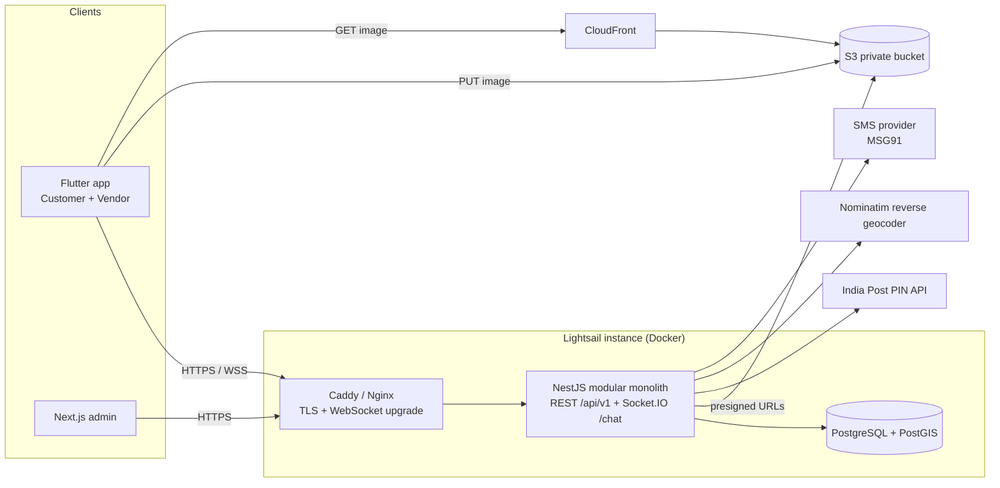
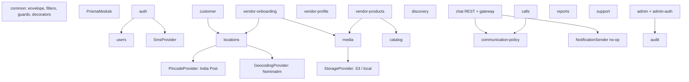
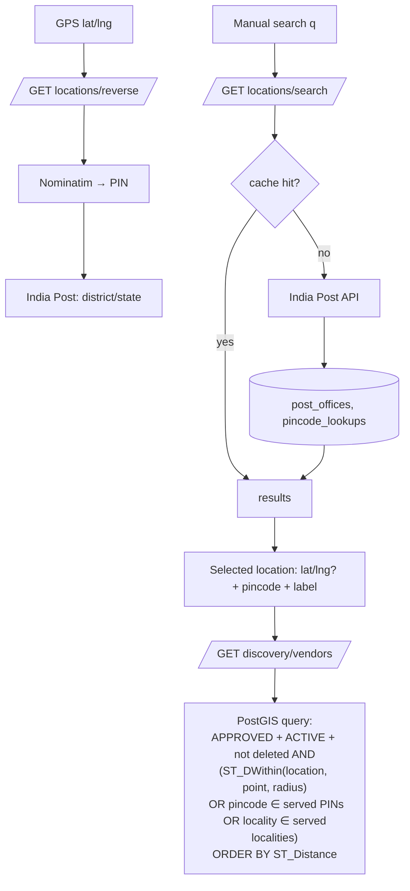
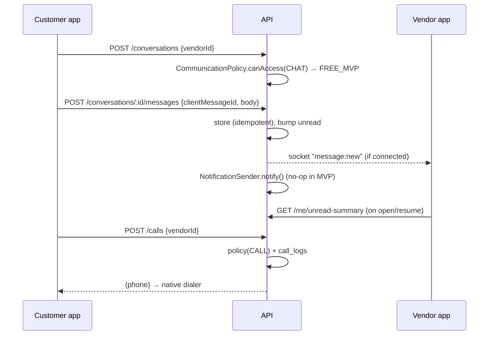
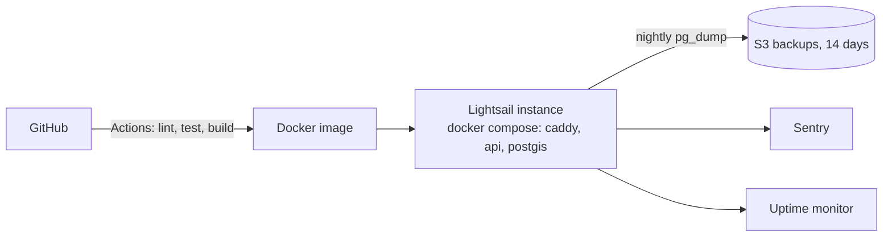

# Milkore — System Architecture

## 1. Components


## 2. Backend modules (NestJS)

Rules: controllers are thin; services hold business rules; ownership comes from the JWT; raw SQL only in repository classes, always parameterised.

## 3. Authentication flow
```mermaid
sequenceDiagram
  participant A as App
  participant API
  participant SMS
  A->>API: POST /auth/login/otp/request {phone}
  API->>API: rate-limit (phone, IP), create OTP (HMAC hash, 5 min)
  API->>SMS: send OTP (console in dev)
  API-->>A: 200 {resendAfterSeconds}
  A->>API: POST /auth/login/otp/verify {phone, otp, deviceId}
  API->>API: check hash, attempts ≤ 5, upsert user
  API-->>A: 200 {accessToken 15m, refreshToken 30d, user, isNewUser}
  A->>API: GET /discovery/... (Bearer)
  API-->>A: 401 (expired)
  A->>API: POST /auth/refresh {refresh_token}
  API->>API: rotate (revoke old, issue new; reuse → revoke chain)
  API-->>A: 200 {accessToken, refreshToken}
```

## 4. Location and discovery


## 5. Chat and calls

Socket.IO runs in the same process. When there is more than one instance, add the Redis adapter (ADR-007).

## 6. File storage
Client asks `POST /media/upload-url` → receives a presigned PUT (5 min) → uploads directly to S3 → `POST /media/:id/confirm` → the API checks size and type, strips EXIF (sharp) and marks the asset READY. Reads go through CloudFront (or presigned GET in dev). In development without AWS keys, a `LocalStorageProvider` writes to `uploads/` and serves `/media/files/*`.

## 7. Deployment

Migrations run with `prisma migrate deploy` during deploy. Rollback = previous image tag + restore point.

## 8. Admin dashboard (Next.js)
App Router; route handlers proxy to the API and keep admin tokens in httpOnly cookies; `middleware.ts` protects all routes except `/login`; TanStack Query for data; shadcn/ui components.
