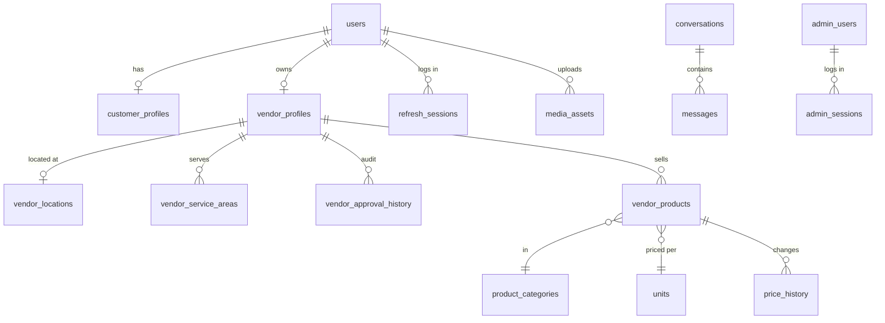

# Milkore — Database Schema

Generated from `prisma/schema.prisma` (source of truth) and the applied migrations in `prisma/migrations/`.
PostgreSQL 16+/18 with **PostGIS**, **pg_trgm**, **pgcrypto**. Tables are snake_case; Prisma fields camelCase.

## Migrations

| Migration | Content |
|---|---|
| `d1_identity_auth_audit` | extensions; users, otp_requests, refresh_sessions, customer_profiles, admin_users, admin_sessions, audit_logs |
| `d2_d3_vendors_catalogue` | vendor_profiles, vendor_locations (GIST), vendor_service_areas, vendor_approval_history, media_assets, post_offices (GIN trigram), pincode_lookups, product_categories, units, vendor_products, price_history + CHECK constraints |
| `d4_chat_calls_access_trust` | conversations, messages, call_logs, communication_access, reports, support_tickets |

## Relationships

Conversations, call_logs, communication_access, reports and support_tickets reference users / vendor_profiles by id (no FK) so account deletion can anonymise without cascading chat history away.

## Key constraints and indexes

- `vendor_locations.location` geography(Point,4326) **GIST** — radius discovery (`ST_DWithin`) and distance sort.
- `post_offices.name` **GIN gin_trgm_ops** — fuzzy area search; `post_offices(name, pincode)` unique.
- CHECKs: 6-digit PIN (`^[1-9][0-9]{5}$`) on locations, service areas, post offices; `radius_meters` 500–20000; service-area shape per type; `price_paise` 100–10,000,000.
- Uniques: `users.phone`, `refresh_sessions.token_hash`, `conversations(customer_id, vendor_id)`, `messages(sender_user_id, client_message_id)` (idempotent send), `communication_access(customer_id, vendor_id, channel)`.
- Secrets are never stored in plain form: `otp_hash` (HMAC), `token_hash` (HMAC with pepper), admin `password_hash` (bcrypt 12).

## Ownership & access

- Vendor data is always selected by the vendor id derived from the JWT; another vendor's row returns 404.
- Public discovery reads only APPROVED, non-deleted vendors of ACTIVE users.
- Customer coordinates are never returned to vendors.

## Tables

### `users` (User)
A person using the mobile app. Identity = verified mobile number (E.164).

| Field | Type | Notes |
|---|---|---|
| id | String | PK, default uuid() |
| phone | String | unique |
| name | String | optional |
| role | UserRole | default CUSTOMER |
| status | UserStatus | default ACTIVE |
| preferredLanguage | Language | default en |
| lastLoginAt | DateTime | optional |
| deletedAt | DateTime | optional |
| createdAt | DateTime | default now() |
| updatedAt | DateTime |  |

Indexes: index [role, status]

### `otp_requests` (OtpRequest)
One OTP sent to a phone. Only the HMAC hash is stored.

| Field | Type | Notes |
|---|---|---|
| id | String | PK, default uuid() |
| phone | String |  |
| otpHash | String |  |
| purpose | OtpPurpose | default LOGIN |
| attempts | Int | default 0 |
| expiresAt | DateTime |  |
| consumedAt | DateTime | optional |
| ipAddress | String | optional |
| deviceId | String | optional |
| createdAt | DateTime | default now() |

Indexes: index [phone, createdAt]; index [ipAddress, createdAt]

### `refresh_sessions` (RefreshSession)
Rotating refresh token. `familyId` links a rotation chain so reuse revokes the whole chain.

| Field | Type | Notes |
|---|---|---|
| id | String | PK, default uuid() |
| userId | String |  |
| tokenHash | String | unique |
| familyId | String |  |
| deviceId | String | optional |
| userAgent | String | optional |
| expiresAt | DateTime |  |
| revokedAt | DateTime | optional |
| replacedById | String | optional |
| lastUsedAt | DateTime | optional |
| createdAt | DateTime | default now() |

Indexes: index [userId]; index [familyId]

### `customer_profiles` (CustomerProfile)
Customer-only data. The saved location is optional (manual PIN selection may have no coordinates).

| Field | Type | Notes |
|---|---|---|
| id | String | PK, default uuid() |
| userId | String | unique |
| location | Unsupported("geography(Point, |  |
| addressLabel | String | optional |
| pincode | String | optional |
| city | String | optional |
| createdAt | DateTime | default now() |
| updatedAt | DateTime |  |

### `admin_users` (AdminUser)
Dashboard user. Completely separate from app users and their tokens.

| Field | Type | Notes |
|---|---|---|
| id | String | PK, default uuid() |
| email | String | unique |
| name | String |  |
| passwordHash | String |  |
| role | AdminRole | default MODERATOR |
| status | AdminStatus | default ACTIVE |
| totpSecret | String | optional |
| failedLoginCount | Int | default 0 |
| lockedUntil | DateTime | optional |
| lastLoginAt | DateTime | optional |
| createdAt | DateTime | default now() |
| updatedAt | DateTime |  |

### `admin_sessions` (AdminSession)

| Field | Type | Notes |
|---|---|---|
| id | String | PK, default uuid() |
| adminId | String |  |
| tokenHash | String | unique |
| familyId | String |  |
| expiresAt | DateTime |  |
| revokedAt | DateTime | optional |
| replacedById | String | optional |
| createdAt | DateTime | default now() |

Indexes: index [adminId]; index [familyId]

### `audit_logs` (AuditLog)
Append-only record of security-relevant and admin actions.

| Field | Type | Notes |
|---|---|---|
| id | String | PK, default uuid() |
| actorType | ActorType |  |
| actorId | String | optional |
| action | String |  |
| entityType | String |  |
| entityId | String | optional |
| metadata | Json | optional |
| ip | String | optional |
| createdAt | DateTime | default now() |

Indexes: index [entityType, entityId]; index [actorId]; index [createdAt]

### `vendor_profiles` (VendorProfile)
A seller's business profile. Exists from the first onboarding step (DRAFT).

| Field | Type | Notes |
|---|---|---|
| id | String | PK, default uuid() |
| userId | String | unique |
| businessName | String | optional |
| ownerName | String | optional |
| description | String | optional |
| operatingHours | Json | optional |
| approvalStatus | VendorApprovalStatus | default DRAFT |
| rejectionReason | String | optional |
| suspensionReason | String | optional |
| onboardingStep | Int | default 0 |
| isAvailable | Boolean | default true |
| contactPhone | String | optional |
| profilePhotoId | String | unique, optional |
| shopPhotoId | String | unique, optional |
| submittedAt | DateTime | optional |
| approvedAt | DateTime | optional |
| approvedByAdminId | String | optional |
| deletedAt | DateTime | optional |
| createdAt | DateTime | default now() |
| updatedAt | DateTime |  |

Indexes: index [approvalStatus]

### `vendor_locations` (VendorLocation)
Where the business physically is. Radius service areas are measured from here.

| Field | Type | Notes |
|---|---|---|
| id | String | PK, default uuid() |
| vendorId | String | unique |
| addressLine | String |  |
| locality | String |  |
| city | String |  |
| district | String |  |
| state | String |  |
| pincode | String |  |
| location | Unsupported("geography(Point, |  |
| createdAt | DateTime | default now() |
| updatedAt | DateTime |  |

Indexes: index [location], type: Gist; index [pincode]

### `vendor_service_areas` (VendorServiceArea)
Where the vendor sells. One RADIUS rule and any number of PINCODE / LOCALITY rules.

| Field | Type | Notes |
|---|---|---|
| id | String | PK, default uuid() |
| vendorId | String |  |
| type | ServiceAreaType |  |
| radiusMeters | Int | optional |
| pincode | String | optional |
| localityName | String | optional |
| createdAt | DateTime | default now() |

Indexes: index [vendorId]; index [pincode]; index [localityName]

### `vendor_approval_history` (VendorApprovalHistory)

| Field | Type | Notes |
|---|---|---|
| id | String | PK, default uuid() |
| vendorId | String |  |
| fromStatus | VendorApprovalStatus |  |
| toStatus | VendorApprovalStatus |  |
| adminId | String | optional |
| note | String | optional |
| createdAt | DateTime | default now() |

Indexes: index [vendorId, createdAt]

### `media_assets` (MediaAsset)
An uploaded image. Clients upload straight to storage with a presigned URL, then confirm.

| Field | Type | Notes |
|---|---|---|
| id | String | PK, default uuid() |
| ownerUserId | String |  |
| purpose | MediaPurpose |  |
| storageKey | String | unique |
| mimeType | String |  |
| sizeBytes | Int |  |
| width | Int | optional |
| height | Int | optional |
| status | MediaStatus | default PENDING_UPLOAD |
| createdAt | DateTime | default now() |
| updatedAt | DateTime |  |

Indexes: index [ownerUserId]

### `post_offices` (PostOffice)
Cache of India Post (api.postalpincode.in) results. The API has no coordinates;

| Field | Type | Notes |
|---|---|---|
| id | String | PK, default uuid() |
| name | String |  |
| pincode | String |  |
| branchType | String | optional |
| deliveryStatus | String | optional |
| circle | String | optional |
| district | String |  |
| division | String | optional |
| region | String | optional |
| state | String |  |
| country | String | default "India" |
| location | Unsupported("geography(Point, |  |
| fetchedAt | DateTime | default now() |

Indexes: unique [name, pincode]; index [pincode]; index [name(ops: raw("gin_trgm_ops"))], type: Gin, map: "post_offices_name_trgm_idx"

### `pincode_lookups` (PincodeLookup)
Remembers which India Post queries were already made (PIN or lowercased branch name).

| Field | Type | Notes |
|---|---|---|
| key | String | PK |
| status | PincodeLookupStatus |  |
| fetchedAt | DateTime | default now() |

### `product_categories` (ProductCategory)

| Field | Type | Notes |
|---|---|---|
| id | String | PK, default uuid() |
| slug | String | unique |
| nameEn | String |  |
| nameHi | String |  |
| iconKey | String |  |
| sortOrder | Int | default 0 |
| isActive | Boolean | default true |
| createdAt | DateTime | default now() |
| updatedAt | DateTime |  |

### `units` (Unit)

| Field | Type | Notes |
|---|---|---|
| id | String | PK, default uuid() |
| code | String | unique |
| labelEn | String |  |
| labelHi | String |  |
| sortOrder | Int | default 0 |

### `vendor_products` (VendorProduct)
A vendor's own listing with its own price (integer paise).

| Field | Type | Notes |
|---|---|---|
| id | String | PK, default uuid() |
| vendorId | String |  |
| categoryId | String |  |
| unitId | String |  |
| name | String |  |
| description | String | optional |
| imageId | String | unique, optional |
| pricePaise | Int |  |
| isAvailable | Boolean | default true |
| moderationStatus | ModerationStatus | default ACTIVE |
| removedReason | String | optional |
| deletedAt | DateTime | optional |
| createdAt | DateTime | default now() |
| updatedAt | DateTime |  |

Indexes: index [vendorId]; index [categoryId, isAvailable]

### `price_history` (PriceHistory)

| Field | Type | Notes |
|---|---|---|
| id | String | PK, default uuid() |
| vendorProductId | String |  |
| oldPricePaise | Int |  |
| newPricePaise | Int |  |
| changedAt | DateTime | default now() |

Indexes: index [vendorProductId, changedAt]

### `conversations` (Conversation)
One thread per (customer, vendor) pair.

| Field | Type | Notes |
|---|---|---|
| id | String | PK, default uuid() |
| customerId | String |  |
| vendorId | String |  |
| status | ConversationStatus | default OPEN |
| blockedByUserId | String | optional |
| lastMessageAt | DateTime | optional |
| lastMessagePreview | String | optional |
| customerUnread | Int | default 0 |
| vendorUnread | Int | default 0 |
| createdAt | DateTime | default now() |
| updatedAt | DateTime |  |

Indexes: unique [customerId, vendorId]; index [customerId, lastMessageAt]; index [vendorId, lastMessageAt]

### `messages` (Message)

| Field | Type | Notes |
|---|---|---|
| id | String | PK, default uuid() |
| conversationId | String |  |
| senderUserId | String |  |
| type | MessageType | default TEXT |
| body | String |  |
| clientMessageId | String |  |
| readAt | DateTime | optional |
| createdAt | DateTime | default now() |

Indexes: unique [senderUserId, clientMessageId]; index [conversationId, createdAt(sort: Desc)]

### `call_logs` (CallLog)
Records a customer tapping "Call" (the phone number reveal), not the call itself.

| Field | Type | Notes |
|---|---|---|
| id | String | PK, default uuid() |
| customerId | String |  |
| vendorId | String |  |
| createdAt | DateTime | default now() |

Indexes: index [vendorId, createdAt]; index [customerId, createdAt]

### `communication_access` (CommunicationAccess)
Who may chat with / call whom. Granted as FREE_MVP today; PAID later without touching chat code.

| Field | Type | Notes |
|---|---|---|
| id | String | PK, default uuid() |
| customerId | String |  |
| vendorId | String |  |
| channel | CommChannel |  |
| source | AccessSource | default FREE_MVP |
| paymentRef | String | optional |
| validUntil | DateTime | optional |
| createdAt | DateTime | default now() |

Indexes: unique [customerId, vendorId, channel]

### `reports` (Report)

| Field | Type | Notes |
|---|---|---|
| id | String | PK, default uuid() |
| reporterUserId | String |  |
| targetType | ReportTarget |  |
| targetId | String |  |
| reason | ReportReason |  |
| details | String | optional |
| status | ReportStatus | default OPEN |
| resolvedByAdminId | String | optional |
| resolutionNote | String | optional |
| resolvedAt | DateTime | optional |
| createdAt | DateTime | default now() |

Indexes: index [status, createdAt]; index [targetType, targetId]

### `support_tickets` (SupportTicket)

| Field | Type | Notes |
|---|---|---|
| id | String | PK, default uuid() |
| userId | String |  |
| subject | String |  |
| message | String |  |
| status | TicketStatus | default OPEN |
| adminNote | String | optional |
| createdAt | DateTime | default now() |
| updatedAt | DateTime |  |

Indexes: index [userId]; index [status, createdAt]
